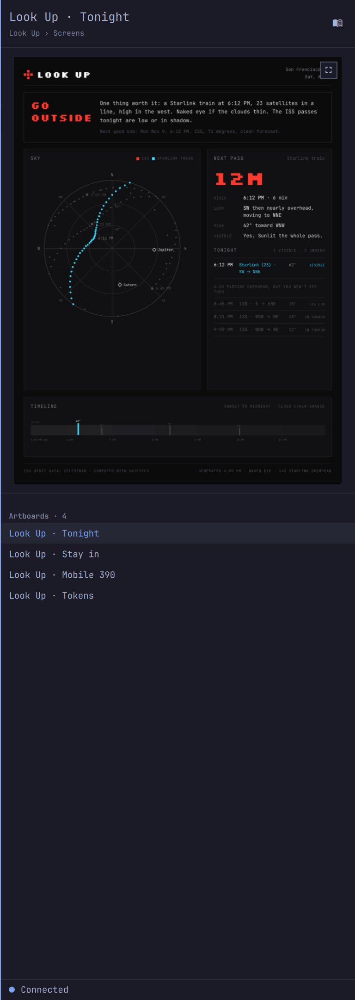

# Paper Peek

Paper Peek shows a Paper artboard beside your code. A hotkey slides a drawer in over your tiled windows, and the same hotkey hides it. Inside the drawer you browse project, page and artboard, and it reopens on the last artboard you were looking at. No links to paste, and no trip to Paper.



## Requirements

**Omarchy 4.** Paper Peek is a plugin for the Omarchy shell and runs inside it.

**Paper Desktop, running, with the file you want to see already open.** Paper Peek only reads. It never opens, selects or changes anything in Paper, and a screenshot needs the file to be open already.

**Node 22.6 or newer on your path.** The helper that talks to Paper runs `node --experimental-strip-types`. With no Node, the drawer says so on its notice line and keeps showing the last artboard it cached.

## Install

```bash
omarchy plugin add https://github.com/binaryfever/paper-peek --enable
```

The command clones the repository, validates `manifest.json`, and enables the plugin. Without `--enable` it asks, and you can enable it later.

```bash
omarchy plugin enable binaryfever.paper-peek
```

The dot's default place is the left of the bar. The plugin id is `binaryfever.paper-peek`.

## Usage

The bar widget is a dot, and its tooltip names the state.

| Dot | Tooltip | What it means |
| --- | --- | --- |
| Theme accent | Connected | An artboard is picked, and Paper answered |
| Urgent | Not connected | Paper did not answer, or the helper could not run |
| Muted | No artboard | Nothing is picked yet |

Click the dot to open the drawer. `SUPER + SHIFT + H` opens it, and the same chord closes it from anywhere, whatever has focus.

The drawer slides in from the right, over your tiled windows. Nothing on the workspace moves: your windows keep their places and their sizes. The header is two lines, the artboard's name and then the project and page it came from. Under the shot, the same column lists that page's artboards, and a click loads one. The footer carries the same dot and word as the bar.

Click the artboard, or the expand control in its top right corner, to open it at the size of the screen. A click anywhere brings the drawer back, on the same artboard, with the rows where you left them. Paper is not called for this, because the big view reads the JPEG already in the cache.

Browse opens the project list, then a project's pages, then a page's artboards. Paper Peek asks Paper for a project's pages the first time you open it and serves its cache after that, so browsing does not pile up tabs in Paper.

While the drawer is open, Paper Peek checks Paper on a timer and fetches a new screenshot only when Paper reports that the file changed. A closed drawer checks at a fifteenth of that rate, because only the bar's dot is reading it.

### Dock mode

The peek can be a tiled window instead of a drawer. `omarchy-shell binaryfever.paper-peek dock` opens the current artboard in an ordinary window titled Paper Peek, which Hyprland tiles like any other, so the workspace splits between the code and the design. `undock` closes it, and so do closing the window and pressing the toggle hotkey. The next press brings the drawer back.

Set `defaultMode` to `dock` to have the hotkey open the tile instead of the drawer. It applies the next time you open the peek, and does not move one that is already open.

## Hotkeys

`SUPER + SHIFT + H` toggles the peek. Set `toggleHotkey` to change it.

`browserHotkey` is empty until you set it. An empty value adds no hotkey.

With the drawer in front of you, Space opens the artboard at the size of the screen, Escape closes the drawer, and Return opens the project browser.

The open drawer does not hold your keyboard. It takes the keys when it opens, so Escape and Space work straight after the hotkey, and it gives them back the moment you click another window. Click the drawer again to steer it with the keys.

While the artboard fills the screen, a click anywhere closes it, and so do Escape and Space.

Each of these is a command you can bind to a key of your own.

| Command | What it does |
| --- | --- |
| `omarchy-shell binaryfever.paper-peek toggle` | Opens the peek, or closes it |
| `omarchy-shell binaryfever.paper-peek open` | Opens the drawer |
| `omarchy-shell binaryfever.paper-peek close` | Closes the drawer |
| `omarchy-shell binaryfever.paper-peek browser` | Opens the project browser |
| `omarchy-shell binaryfever.paper-peek zoom` | Opens the artboard at the size of the screen, and closes it again |
| `omarchy-shell binaryfever.paper-peek dock` | Opens the tiled window |
| `omarchy-shell binaryfever.paper-peek undock` | Closes the tiled window |
| `omarchy-shell binaryfever.paper-peek status` | Prints `live`, `not-live` or `off` |

## Settings

Change Paper Peek in `~/.config/paper-peek/settings.json`. With no file, Paper Peek keeps the defaults in the table. Leave a key out to keep its default. An invalid value falls back to the default, and the shell logs a warning that starts with `paper-peek:`. Saving a new `drawerSide` moves the open drawer without a shell restart.

| Key | Default | What it sets |
| --- | --- | --- |
| `toggleHotkey` | `SUPER + SHIFT + H` | Hotkey that toggles the peek |
| `browserHotkey` | empty | Hotkey that opens the project browser. Empty adds no hotkey |
| `drawerSide` | `right` | `left` or `right` |
| `drawerWidth` | `480` | Drawer width in pixels, from 240 to 1200 |
| `refreshIntervalMs` | `2000` | Milliseconds between Paper checks while the drawer is open, from 500 to 60000. A closed drawer checks at a fifteenth of that rate. Opening the drawer checks at once |
| `defaultMode` | `drawer` | `drawer` or `dock` on the next open |
| `paperAddress` | `127.0.0.1:29979` | Paper's host and port. Requests go to that host and port on the path `/mcp` |
| `cacheBudgetMb` | `200` | Cap on cached screenshots, in megabytes, from 0 to 1048576. 0 keeps the current artboard and the five recents |

```json
{
  "drawerSide": "left",
  "drawerWidth": 560
}
```

`PAPER_MCP_URL` overrides `paperAddress` when you run `scripts/paper-fetch` yourself.

## What Paper Peek writes

| Path | What it holds |
| --- | --- |
| `~/.config/paper-peek/` | Your `settings.json`. Paper Peek creates the directory and only ever reads the file |
| `~/.cache/paper-peek/` | The project, page and artboard lists, and the artboard screenshots, capped by `cacheBudgetMb` |
| `~/.local/state/paper-peek/` | The artboard to reopen on, the word the bar's dot reads, and a log of the calls made to Paper |

Paper Peek binds its two chords at runtime with `hyprctl eval`. It does not edit `bindings.lua`, your Hyprland config, or any other file of yours, and with no settings file it leaves an existing `SUPER + SHIFT + H` bind alone. Nothing it writes lives outside the three directories above.

## Remove

```bash
omarchy plugin remove binaryfever.paper-peek
```

`omarchy plugin disable binaryfever.paper-peek` takes the dot off the bar and leaves the install in place. Removing the plugin leaves the three directories above as they are; delete them by hand if you want them gone.

## Where the code lives

Paper Peek is published from [binaryfever/paper-peek](https://github.com/binaryfever/paper-peek), which carries only the files an install needs. The work lives in [binaryfever/omarchy-paper-peek](https://github.com/binaryfever/omarchy-paper-peek): the decision records, the notes on Paper's MCP server, and the tests.

## License

MIT. See [LICENSE](LICENSE).
